<div align="center">
  
  <h1>Swiftz</h1>
  <p>Discover your next favorite movie or TV show.</p>
</div>

Swiftz brings movies, TV shows, and the people behind them together in a
responsive discovery experience powered by [The Movie Database (TMDB)](https://www.themoviedb.org/).
Browse what's popular, explore the details, and keep track of your favorites.

## ✨ Features

- **Discover movies and TV:** Browse trending, popular, and top-rated titles, or
  narrow your search with filters.
- **Explore the details:** Find cast and crew, reviews, recommendations, photos,
  videos, and TV season and episode information.
- **Get to know the people:** Explore biographies, known-for titles, and credits.
- **Make it yours:** Sign in with TMDB to manage favorites, watchlists, and
  ratings. Your library brings your saved movies together.
- **Browse comfortably:** Enjoy responsive layouts and light and dark themes.

## 📸 Explore Swiftz

### Home and discovery

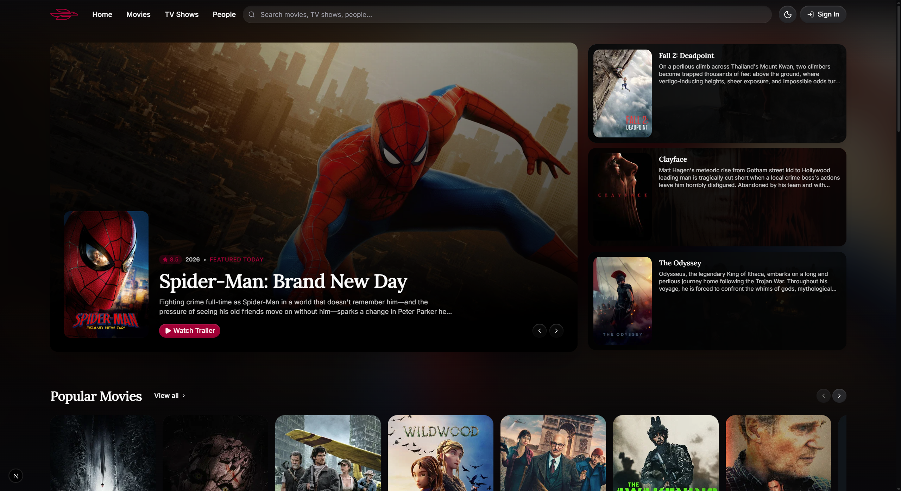

| Browse movies                                     | Browse TV shows                                  |
| ------------------------------------------------- | ------------------------------------------------ |
| 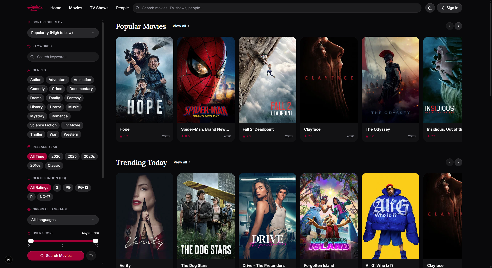 | 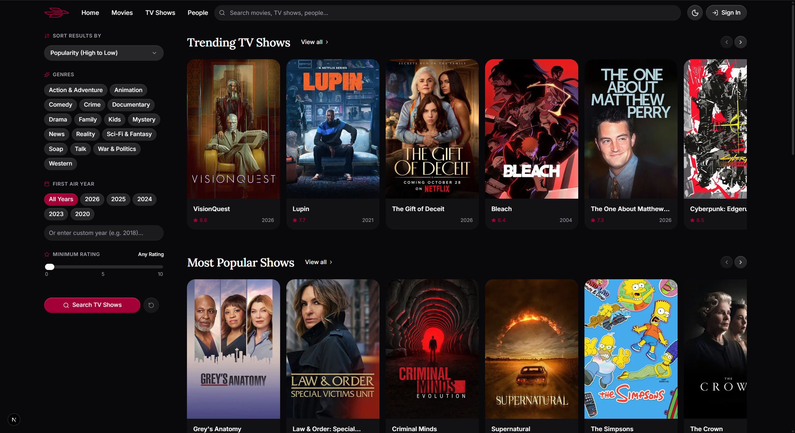 |

### Details and people

| Movie details                                   | TV show details                                     |
| ----------------------------------------------- | --------------------------------------------------- |
| 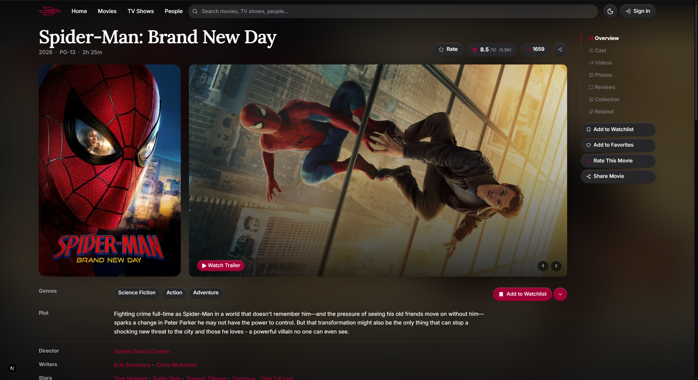 | 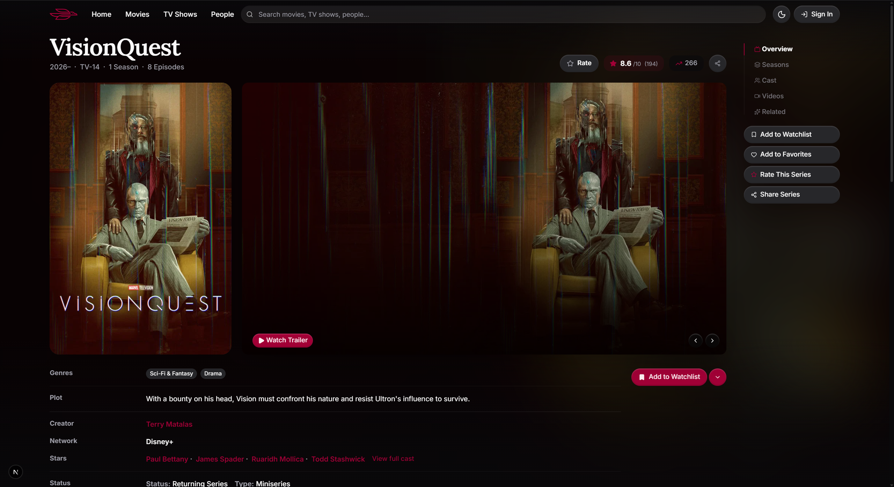 |

| Cast                                       | Person details                                    |
| ------------------------------------------ | ------------------------------------------------- |
| 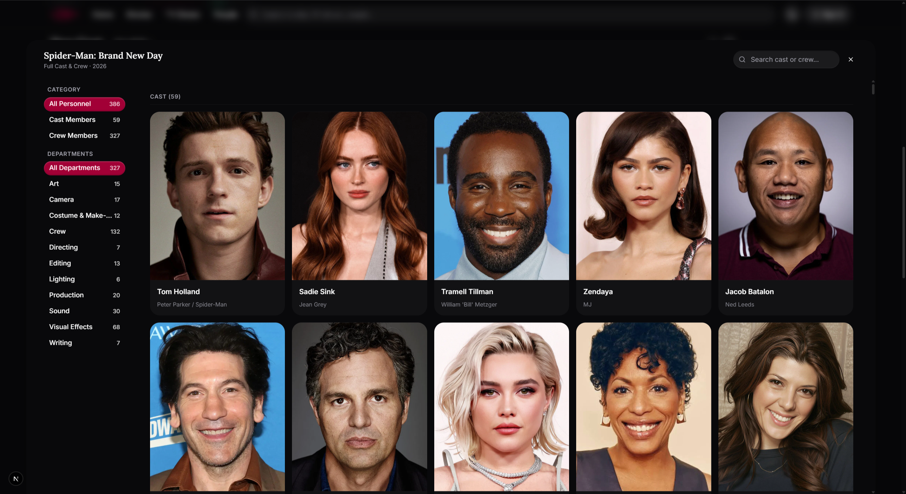 | 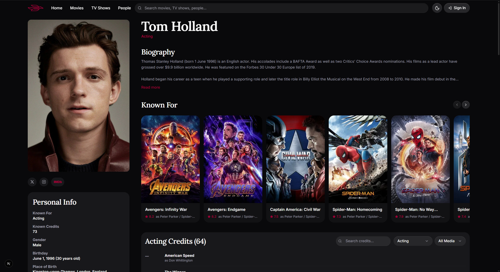 |

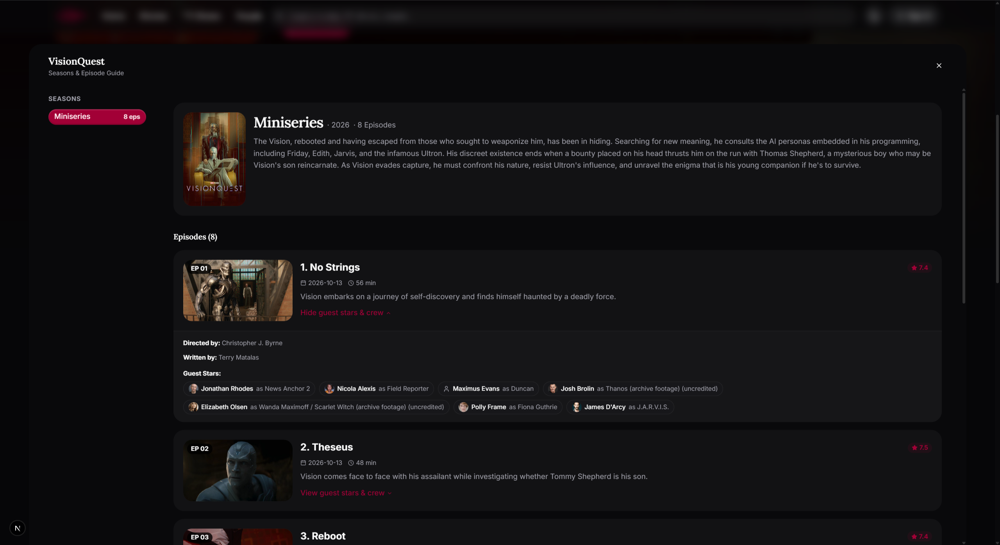

### More to explore

| Recommendations                                                 | Reviews                                         |
| --------------------------------------------------------------- | ----------------------------------------------- |
| 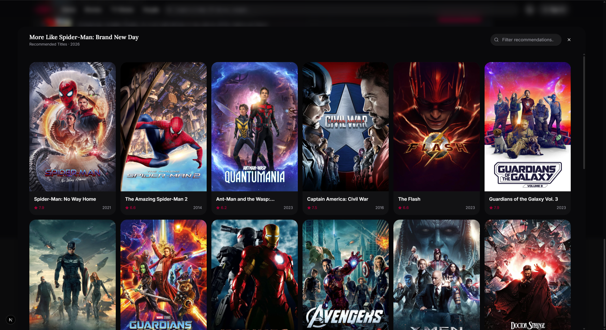 | 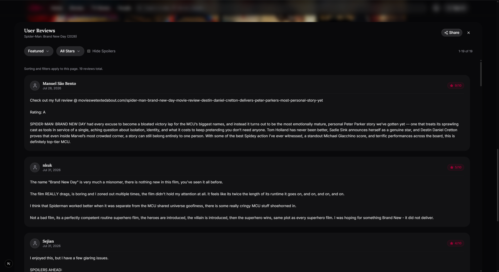 |

| Photo gallery                                               | Full photo view                                           |
| ----------------------------------------------------------- | --------------------------------------------------------- |
| 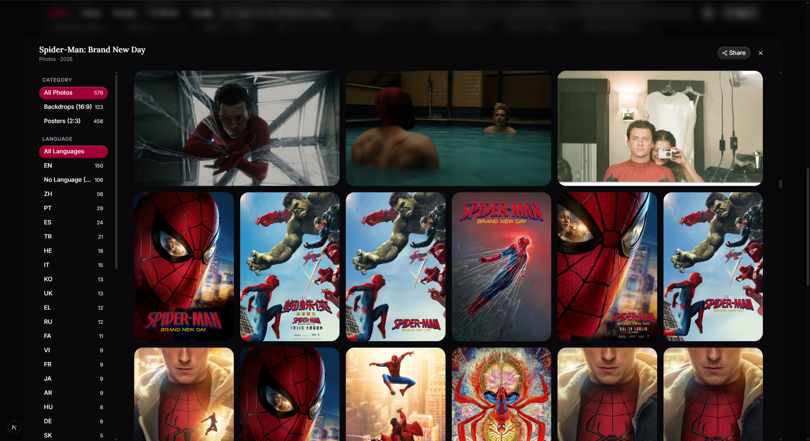 | 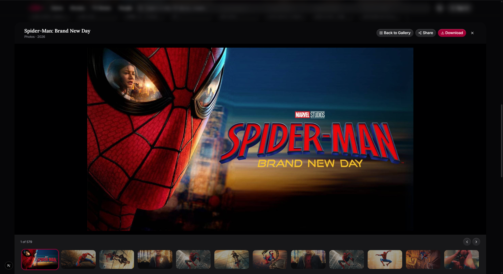 |

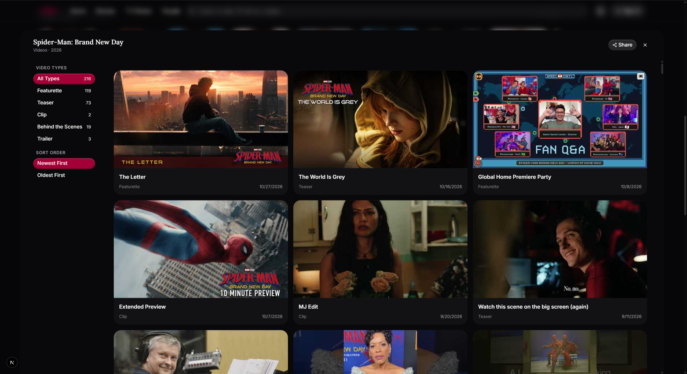

## 🚀 Get started

You'll need Node.js, [pnpm](https://pnpm.io/), and a TMDB v3 API key. The
repository pins pnpm in `package.json`; Corepack can select that version for you.

1. Install dependencies:

   ```sh
   pnpm install --frozen-lockfile
   ```

2. Copy `.env.example` to `.env.local` and set `NEXT_PUBLIC_TMDB_API_KEY` to
   your TMDB v3 API key. This value is exposed to the browser. An optional
   `TMDB_API_KEY` can provide a separate server-side key.
3. Start the development server:

   ```sh
   pnpm dev
   ```

4. Open [http://localhost:3000](http://localhost:3000).

For production, set `NEXT_PUBLIC_SITE_URL` to your deployment's canonical
origin. See the [deployment guide](docs/DEPLOYMENT.md) for environment variables,
Vercel setup, caching, and data delivery.

## 🛠️ Built with

- [Next.js](https://nextjs.org/) and [React](https://react.dev/)
- [Tailwind CSS](https://tailwindcss.com/) and [shadcn/ui](https://ui.shadcn.com/)
- [TanStack Query](https://tanstack.com/query) and native fetch
- [Lucide](https://lucide.dev/) icons and responsive images served by TMDB

## ✅ Development checks

```sh
pnpm format:check
pnpm exec tsc --noEmit
pnpm lint
pnpm test
pnpm build
```

The production build requires a working TMDB key and access to its resources.
See the [architecture guide](docs/ARCHITECTURE.md) for project structure and
conventions.

## 📄 License

Swiftz is available under the [MIT License](LICENSE).

## 🙏 Acknowledgments

Movie and television data and images are provided by
[TMDB](https://www.themoviedb.org/). This product uses the TMDB API but is not
endorsed or certified by TMDB.
